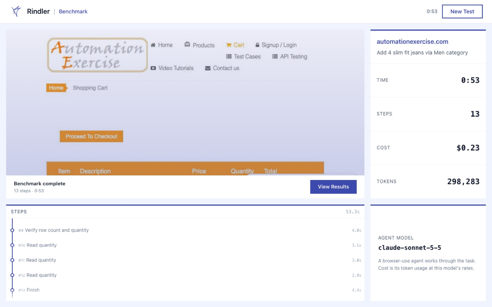
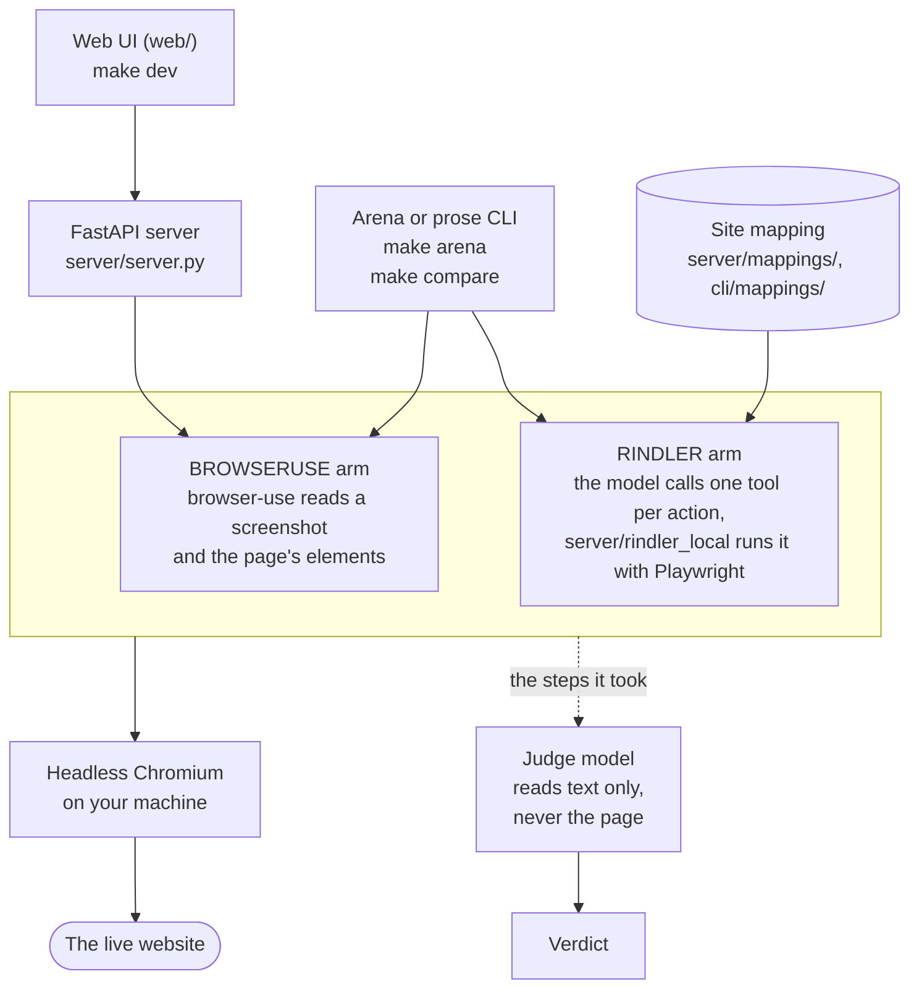

# agent-benchmark

A benchmark that puts a normal browser agent and a site-mapped agent on the same shopping tasks and measures what happens.

- **browser-use** ([browser-use/browser-use](https://github.com/browser-use/browser-use)) looks at a screenshot and the page's element list and decides what to click, one step at a time.
- **Rindler** drives the site through a hand-written *site mapping*: the site's screens and actions (`search_products`, `add_to_cart`, `checkout`, ...) with the selectors, fallbacks and popup handling each one needs. Every action becomes a tool, so the model picks from a few named tools instead of reading raw pages.

A judge model grades each run, and each run records its time, steps, tokens and cost.

It was built at Rindler, the company behind the Rindler agent ([provenance](#provenance)). The Rindler servers it used are retired, so this version runs on one machine with one Anthropic API key and nothing else: no Rindler service, OpenAI key, Clerk, Cloudflare or Browserbase. `server/rindler_local/` runs a mapping in-process with Playwright.

## What it found

In March 2026 the judge passed 59 of 60 Rindler runs and 1 of 60 BrowserUse runs, on one task on one hand-mapped Shopify store. Both arms ran gpt-4o. A Rindler run cost $0.14 on average and a BrowserUse run $0.71, as tokens priced at gpt-4o list rates, not bills.

That shows a hand-mapped site makes this task easy for an agent. It isn't a fair contest between two agents, so quote it with all seven caveats:

1. Rindler drove a hand-mapped site. Its mapping went through 25 versions tuned on this exact site and task, and its own cleanup step meets the "no VIP Membership" check. BrowserUse had no mapping.
2. The task text both arms got used Rindler's words ("Start a session", "call view_cart"). It has since been taken out of the scenarios.
3. BrowserUse ran in a Browserbase cloud browser with a 30-step cap. Rindler ran Playwright on Rindler's own server with a 25-step cap.
4. The judge was gpt-4o-mini reading the agent's own final report, and it can err in either direction.
5. One site, one task, one night (2026-03-31), against a live store that has changed since. The runs can't be reproduced against the store now.
6. The shipt numbers are tiny: 1 BrowserUse run against 2 Rindler runs. The February comparisons, of BrowserUse against BrowserUse with Rindler's tools over MCP, used an older judge and must not be pooled with March.
7. Log file names carry the runner's local time, not UTC. That night's commits are at UTC-4.

[docs/results.md](docs/results.md) has the full table, each caveat in full and the October 2026 local runs.

<p align="center">
  
</p>

<sub>The log viewer (`make viewer`). Its caveats panel sits under the numbers, so a screenshot of the headline carries a shorter list of six.</sub>

## Quickstart

You need [uv](https://docs.astral.sh/uv/getting-started/installation/), which uses a Python 3.11 you have or fetches one, Node.js 20 or newer with npm, and `make`. `web/.nvmrc` names Node 22. Built and checked on an Apple silicon Mac, also checked on Debian 12 Linux on arm64. Windows wasn't tried.

```bash
cp .env.example .env   # then put your key after ANTHROPIC_API_KEY=
make setup             # once: uv sync, Playwright's Chromium, npm ci for web/ and viewer/, a pre-commit key check
make dev               # backend on 127.0.0.1:8000, web UI on http://localhost:5180
```

`make setup` ends by starting Chromium once. On a bare Linux system that fails for missing libraries, and setup stops with the fix: `(cd server && uv run playwright install-deps chromium)` on Debian or Ubuntu (asks for sudo unless you're root), or your package manager. Then run `make setup` again.

Open the URL `make dev` prints (`localhost` and `127.0.0.1` both work) and paste a shop's address. Generated tasks can pass today on the practice shop [automationexercise.com](https://automationexercise.com) and usually fail on books.toscrape.com ([why](docs/limits.md)). Pick one of the three tasks the model proposes and press **Run Benchmark**. You see each step as it happens, then the judge's verdict. Ctrl-C stops both servers.

No key yet? Skip the `.env` step and run `make demo` instead of `make dev`: the same UI with canned runs and tasks, no browser, no cost. Every screen past the landing page says "Demo mode". `make test` runs every [test suite](docs/testing.md) offline, also with no key.

Only `ANTHROPIC_API_KEY` is required. The other settings are in [docs/configuration.md](docs/configuration.md).



<sub>A finished run on automationexercise.com: the agent's last page, its time, steps, cost and tokens, and its last steps.</sub>

## How it works



The web UI has the server run a browser-use agent on a site you paste. The arena and the prose CLI run one task on either arm so you can compare. When the agent stops, a judge model reads what it did. No judge ever sees the site, so a pass means the judge believed the text it was given.

| | BROWSERUSE | RINDLER |
|---|---|---|
| drives the browser with | browser-use, screenshots plus the page's elements | the model calling one tool per mapping action, run by `rindler_local` with Playwright |
| knows the site | no | yes, through a mapping: `server/mappings/<site>.json` (arena) or `cli/mappings/prose.json` (CLI) |
| runs on | any site | vhlistings.com and shipt.com (arena), prose.com (CLI) |

In the arena both arms get the same model (`--model`), step budget (`--max-steps`, default 30) and neutral task text, a local headless Chromium and prompt caching. Both log every model call's tokens, so costs compare like for like.

## What you can run

`make` alone lists every target. The costs are from single runs on claude-sonnet-5-5, the default model.

| what | folder | command | one run costs |
|---|---|---|---|
| Live benchmark | `web/`, `server/` | `make dev` | $0.15 to $0.41 of agent tokens |
| Arena | `server/` | `make arena AGENT=... SCENARIO=...` | about $0.02 to $0.03 on Rindler, $0.20 to $0.71 on BrowserUse |
| prose CLI | `cli/` | `make compare TASK=...` | about 10 to 20 cents, one task on both arms |
| Log viewer | `viewer/` | `make viewer` | free, no key |
| Web UI demo | `web/`, `server/` | `make demo` | free, no key |

`server/` is one uv package holding the live-benchmark API, Michael's arena, the local Rindler interpreter, the mappings and the March logs.

### Live benchmark

This is what the Quickstart runs. A run ends as `pass`, `fail`, `too_slow` or `error`, and [docs/live-benchmark.md](docs/live-benchmark.md) says how it is judged.

### Arena

`server/arena.py` runs one of about 30 scenarios (`server/scenarios/definitions.py`) on one arm and has a judge grade it. Run both arms on a scenario to compare. Every arena run is real and costs money, so `make arena` prints its usage and exits 2 unless it gets both `AGENT` and `SCENARIO`.

```bash
make arena-list   # the arms and the scenarios
make arena AGENT=RINDLER    SCENARIO=vhlistings_product_attribute_search
make arena AGENT=BROWSERUSE SCENARIO=vhlistings_product_attribute_search
make analyze      # a table over arena_logs/ and arena_runs/
```

New logs go to `server/arena_runs/` in the March format plus a few fields. [server/README.md](server/README.md) has the flags, what the judge reads, the log format and the mappings.

### prose CLI

`cli/` runs ten prose.com tasks (browsing, adding accessories to a cart) on both arms with the same model and step budget, judges them and draws charts. It refuses a task whose text names a Rindler tool. `make compare-tools` and `make compare-tasks` need no key, and `make compare TASK=add-hair-towel` runs one task on both arms. It's experimental: the numbers don't compare with March, and `instructions/prose-hard.yaml` is stale since prose.com's prices changed. See [cli/README.md](cli/README.md).

### Log viewer

`make viewer` serves the March logs at http://localhost:5173 (127.0.0.1 works too). The log view shows each run's verdict, step timeline, cost chart and friction flags, and takes any arena-format `.log` you drop in. See [viewer/README.md](viewer/README.md).

## Provenance

Michelle Serrano (`meetchie`), Michael Serrano and Arthur De Los Santos built it at Rindler. Counting the original commits, from December 2025 to August 2026, the web app is mostly Michelle's at 71 of 91, the server and the arena mostly Michael's at 114 of 159, and the CLI Arthur's at 35 of 36. To check: `git shortlog -sn --before=2026-09-01 HEAD -- <folder>`.

The history keeps the original authors and dates: 326 commits from December 2025 to March 2026 and 11 web app commits from April to August 2026. All three authors' commits use their GitHub noreply addresses. In October 2026 it was extracted from the company's monorepo and adapted to run standalone. The October commits are that adaptation. The retired hosted setup was not kept, nor were four March commits that only touched it.

Redacted at extraction: two street addresses used as task input, staff email addresses and third-party account identifiers, such as the Browserbase account in session replay links. Two entries for internal tools of Rindler's hosted platform were removed from the tool list in the six Rindler context logs in `server/arena_logs/`. [docs/provenance.md](docs/provenance.md) has the rest.

## Docs

- [Live benchmark](docs/live-benchmark.md): scoring, run states, screens, API
- [Results](docs/results.md): March 2026 in full, October 2026 local runs
- [Configuration](docs/configuration.md): every setting, Clerk, OpenAI, Browserbase
- [Limits](docs/limits.md), [Testing](docs/testing.md), [Provenance](docs/provenance.md)
- Per folder: [web](web/README.md), [server](server/README.md) and its [SETUP](server/SETUP.md), [cli](cli/README.md), [viewer](viewer/README.md)
