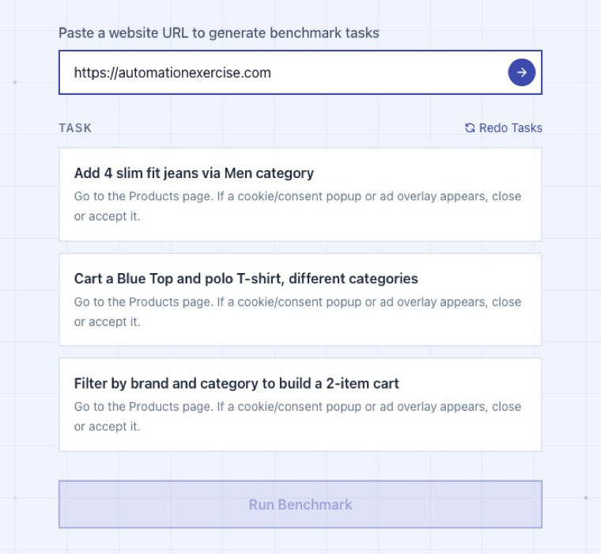

# agent-benchmark

A benchmark that puts a **normal browser agent** and a **site-mapped agent** on the same shopping tasks and measures what happens.

- **browser-use** is the normal agent ([browser-use/browser-use](https://github.com/browser-use/browser-use)). It looks at a page (a screenshot and the element list) and decides what to click, one step at a time.
- **Rindler** drives a site through a hand-written *site mapping*. A mapping lists the site's screens and actions (`search_products`, `add_to_cart`, `checkout`, ...) with the selectors, fallbacks and popup handling needed to run each one. Every action becomes a tool, so the model chooses between a few named tools instead of reading raw pages.

Each run is graded by a judge model and records its time, steps, tokens and cost.

It was built at Rindler, the company behind the Rindler agent, from December 2025 to March 2026, with later changes to the web app up to August 2026 (see [Provenance](#provenance)). The Rindler servers behind it are retired, so this repository has been adapted to run on one machine with **one Anthropic API key**: no Rindler service, OpenAI key, Clerk account, Cloudflare or Browserbase is needed. A mapping is run in-process by `server/rindler_local/` with Playwright.

## What it found

In March 2026, on one task on one hand-mapped Shopify store, the judge passed **59 of 60 Rindler runs and 1 of 60 BrowserUse runs** (both arms on gpt-4o).

> [!WARNING]
> This is evidence that a hand-mapped site makes this task easy for an agent, not a fair contest between two agents. Read [the seven caveats](#the-seven-caveats) before you quote it.

**Try it:** after `make setup`, `make demo` runs the web UI with canned runs (no key, no cost) and `make dev` runs it for real with your key. [Quickstart](#quickstart) has the steps.

<p align="center">
  
</p>

<sub>The results page of the log viewer (`make viewer`, no key needed). The caveats panel sits right under the numbers, so a screenshot of the headline carries its own shorter list of six caveats.</sub>

## Contents

- [Quickstart](#quickstart): running in three commands, or with no key at all
- [How it works](#how-it-works): the two arms, the judge, and what is in each folder
- [What you can run](#what-you-can-run): the [live benchmark](#the-live-benchmark), the [arena](#the-head-to-head-arena), the [prose CLI](#the-prose-comparison-cli), the [log viewer](#the-log-viewer) and the [main `make` targets](#the-main-make-targets)
- [Results](#results): the [March 2026 result](#the-archived-march-2026-result), [the seven caveats](#the-seven-caveats) and the [new local runs](#new-local-runs)
- [Configuration](#configuration), [Limits](#limits), [Tests](#tests), [Optional setups](#optional-setups), [Provenance](#provenance)

## Quickstart

You need [uv](https://docs.astral.sh/uv/getting-started/installation/) (it uses a Python 3.11 you already have, or fetches one itself), Node.js 20 or newer with npm (`web/.nvmrc` says 22) and `make`.

It was built and checked on macOS (Apple silicon). It also runs on Linux (checked on Debian 12, arm64), where Chromium needs system libraries that a bare system lacks (step 2 says how to add them). Windows was not tried.

> [!TIP]
> **No key yet?** Skip step 1 and run `make demo` instead of `make dev` in step 3. It starts the same UI with canned runs and tasks, so the whole flow works with no key, no browser and no cost. A canned run plays the same generic steps (open the site, find the product, add it to the cart, check the cart) whichever task you pick. The UI says "Demo mode" on every screen after the landing page, so a canned run is never taken for a real one.

1. Copy the settings file, then open `.env` and put your key after `ANTHROPIC_API_KEY=`:

   ```bash
   cp .env.example .env
   ```

2. Install everything, once: `uv sync`, Playwright's Chromium, `npm ci` for `web/` and `viewer/`, and a pre-commit key check. It then starts Chromium once, to check that it runs.

   ```bash
   make setup
   ```

   **On Linux**, Chromium needs system libraries that a bare system lacks. `make setup` ends by starting Chromium once and, if it cannot, stops with this advice: add them once with the command below (Debian or Ubuntu; it asks for sudo unless you are root), or with your package manager, then run `make setup` again.

   ```bash
   (cd server && uv run playwright install-deps chromium)
   ```

3. Start the backend (on 127.0.0.1:8000) and the web UI (on http://localhost:5180):

   ```bash
   make dev
   ```

4. Open the URL `make dev` prints. `http://localhost:5180` and `http://127.0.0.1:5180` both work.
5. Paste the address of a shop. [https://automationexercise.com](https://automationexercise.com) is a practice shop where a generated task can pass today (see [Live benchmark runs](#live-benchmark-runs)); on books.toscrape.com they usually fail (see [Limits](#limits)).
6. Pick one of the three tasks the model proposes and press **Run Benchmark**. The UI shows each step as it happens, then the judge's verdict.
7. Ctrl-C in the terminal stops both servers.


<sub>A real run on automationexercise.com on 2026-10-25 that the judge passed from the step text alone (it now reads more, see [Live benchmark runs](#live-benchmark-runs)), as the run view shows it after you close the results card that opens when the agent stops: the last page the agent saw, its time, steps, cost and tokens, and the list of steps it took. **View Results** reopens the judge's verdict, summary and phases.</sub>

## How it works


There are three ways to start a run. The **web UI** asks the FastAPI server to run a browser-use agent on a site you paste. The **arena** and the **prose CLI** run the same task on either arm, so you can compare them. Both arms drive a local headless Chromium. When the agent stops, a judge model reads what it did and gives the verdict. No judge sees the site, so a pass means the judge believed the text it was given.

The arena's commands and logs call the two arms `BROWSERUSE` and `RINDLER`; the CLI and the March tables write BrowserUse and Rindler. browser-use, in lower case, is the open-source agent that the BrowserUse arm runs. The two arms side by side:

| | BROWSERUSE | RINDLER |
|---|---|---|
| drives the browser with | browser-use, screenshots plus the page's elements | the model calling one tool per mapping action, run by `rindler_local` with Playwright |
| knows the site | no | yes, through a mapping: `server/mappings/<site>.json` (arena) or `cli/mappings/prose.json` (CLI) |
| runs on | any site | vhlistings.com and shipt.com (arena), prose.com (CLI) |

In the arena, both arms use the same model (`--model`), the same step budget (`--max-steps`, default 30), a local headless Chromium, prompt caching, and the same neutral task text, and both log every model call's tokens so costs compare like for like.

### What is in here

| folder | what it is |
|---|---|
| `web/` | The live benchmark UI (React + Vite). Paste a site's URL, pick one of three generated tasks, watch a browser-use agent try it. |
| `server/` | One Python package (uv). The FastAPI **live-benchmark API** behind `web/`, Michael's head-to-head **arena** (`arena.py`), the local Rindler interpreter (`rindler_local/`), the site mappings (`mappings/`) and the archived March 2026 arena logs (`arena_logs/`). |
| `cli/` | Arthur's **prose.com comparison CLI**: the same tasks on both arms, judged, with charts. Experimental. |
| `viewer/` | A static **log viewer** for the archived March 2026 arena logs, with the headline results page. Needs no key. |

Each folder has its own README with the details: [web](web/README.md), [server](server/README.md) (and [SETUP](server/SETUP.md)), [cli](cli/README.md), [viewer](viewer/README.md).

## What you can run

| what | command | cost of one run |
|---|---|---|
| [Live benchmark](#the-live-benchmark) | `make dev` | $0.15 to $0.41 of agent tokens ([runs below](#live-benchmark-runs)) |
| [Arena](#the-head-to-head-arena) | `make arena AGENT=... SCENARIO=...` | about $0.02 to $0.03 on the Rindler arm, $0.20 to $0.71 on BrowserUse ([runs below](#arena-and-cli-runs)) |
| [prose CLI](#the-prose-comparison-cli) | `make compare TASK=...` | about 10 to 20 cents for one task on both arms |
| [Log viewer](#the-log-viewer) | `make viewer` | free, no key |
| [Web UI demo](#quickstart) | `make demo` | free, no key |

Everything that costs money needs an Anthropic key (`ANTHROPIC_API_KEY`, see [Configuration](#configuration)). The costs are from single runs on claude-sonnet-5-5, the default model.

### The live benchmark

Start it with the command below, then open http://localhost:5180.

```bash
make dev
```

You give the web app a site URL. The server fetches the page and a model proposes three tasks for it (commerce sites only, anything else answers 422). You pick one and the server starts a browser-use agent in a throwaway headless Chromium, using `BENCHMARK_AGENT_MODEL`. The UI polls the run and shows each step as it happens. A URL that does not resolve, or that points at this machine or an internal address (in any notation, IPv4-mapped IPv6 included), is refused with a 422 that says which ("Could not resolve this host: ..." or "Invalid or disallowed URL: ..."). When the server fetches the page for task generation it follows redirects one at a time and checks each target the same way. The agent itself browses like any browser, so once it is on the site it can follow the site's own links and redirects.

<p align="center">
  
</p>

**How a run is scored.** When the agent stops, a judge model (`BENCHMARK_JUDGE_MODEL`) reads these and decides:

- the task, and the list of steps with their timings;
- under each step, the agent's own evaluation of the step before and each browser action that ran, with what browser-use returned for it: page text for an action that extracts or reads the page (cut to 600 characters), a short note for a click or a navigation (`Clicked a "View Cart"`), or an error;
- after the steps, if the agent finished on its own, the agent's final report.

It never sees the page or a screenshot, so a check the task asks for (a quantity, a price, a total) counts only when that text says what the agent found, and a report that only says it worked does not count. The evaluations and the report are the agent's own words (the report is marked to the judge as the agent's own claim), so a pass means the judge believed them, not that anyone looked at the site. The status reply and the run file keep the report the judge read as `final_report`, and the success flag the agent set with it as `agent_reported_success`.

A task that cannot be done as written (a product the site does not have, a code it rejects) is a fail even when the agent finds that out and says so, and a run whose agent itself reported that it did not succeed is never a pass, whatever the judge says. The run ends in one of four states:

| state | meaning |
|---|---|
| `pass` | The judge says the agent fully completed the task as written, including verification, with the result of every check the task asks for in the steps or the final report, and the agent did not report that it failed. |
| `fail` | The agent ran to the end and the judge says it did not. |
| `too_slow` | The agent was still going after `BENCHMARK_TIMEOUT_S` (default 180 s) and was stopped. The judge still reads the steps it took (there is no final report) and marks no phase as failed. |
| `error` | The run could not be judged as a pass or fail: the model refused part-way, every step the model drove failed (a bad API key, say), the judge itself failed (the API key rejected, a rate limit, a timeout), Chromium is missing or cannot start, a setting is invalid, the run crashed, you cancelled it, or the server stopped during it. The message says which. If the agent had taken steps (a refusal or crash part-way), the judge still reads them and the results card shows its summary and phases under the message. |

**Cancelling keeps the bill.** A cancelled run ends as `error` with "Run cancelled by user." and keeps the time, tokens and cost it had used by then, in the status reply and in the saved run file, because those model calls were paid for.

The judge also groups the steps into 3 to 6 **phases** named for what the user was trying to do ("Find the right yoga mat", "Verify cart contents"). The judge is told to flag a phase as *slow* when it took more than 45 seconds or showed pointless retries (and to flag the slowest one even if nothing was slow; it usually does, but nothing enforces it), and, on a failed run, to flag the phase where it went wrong as *failed*: the agent's mistake, or where it found that the task could not be done. The server keeps at most one failed phase and none on a pass or a `too_slow` run. The results screen shows the verdict, summary, the agent's final report (and whether the agent said it succeeded), phases, time, steps, tokens and the cost in dollars for the agent's tokens at the agent model's prices. A model without a price table shows tokens only.

<details>
<summary><b>What the screens show during and after a run, where runs are saved, and the API</b></summary>

<br>

- **Cost and Tokens read "—" while the agent is working.** Both are the backend's numbers and arrive when the agent stops, so the UI estimates nothing. Tokens count everything billed: the prompt (cache reads included), cache writes and the output.
- **The UI waits as long as the server does.** It polls a run for `BENCHMARK_TIMEOUT_S` plus 180 s for the judge (at least 5 minutes, 10 minutes if it cannot read the limit) before it reports a lost connection, so raising the limit on the server raises it in the UI. It reads the limit from `GET /health`.
- **Demo mode is labelled.** With `DEMO_MODE=true` every screen after the landing page carries a "Demo mode: canned runs, no real agent or API calls" banner.

Finished runs are saved as JSON in `server/runs/` (gitignored). When the server stops during a run it cancels the run, closes its browser and saves it as an `error`; a run file still marked `running` because the server was killed outright is marked `error` the next time the server starts.

The API is `POST /benchmark/start`, `GET /benchmark/status/{id}`, `GET /benchmark/frame/{id}` (the newest picture of the run's page), `POST /benchmark/cancel/{id}`, `POST /benchmark/generate-tasks` (at most 5 requests a minute from one address, refused ones included; the sixth answers 429), `GET /benchmark/quota` and `GET /health`. `/health` reports the provider, the models, the auth mode, `demo_mode` and `timeout_s` (`BENCHMARK_TIMEOUT_S` in whole seconds) and never a key. [web/README.md](web/README.md) has the full map of UI calls to backend routes.

</details>

### The head-to-head arena

`server/arena.py` runs one scenario on one of two **arms** (see [How it works](#how-it-works)) and has a judge grade it. Run both arms on the same scenario to compare them. About 30 scenarios are defined in `server/scenarios/definitions.py`. Every arena run is real and costs money.

```bash
make arena-list
make arena AGENT=RINDLER    SCENARIO=vhlistings_product_attribute_search
make arena AGENT=BROWSERUSE SCENARIO=vhlistings_product_attribute_search
make analyze
```

`make arena-list` shows the arms and the scenarios, and `make analyze` prints a table over `arena_logs/` and `arena_runs/`.

The judge gets the goal, the scenario's success criteria, the agent's own report and its step trace, and answers PASS or FAIL. Each step in the trace is the action it ran with its arguments, on both arms: `search_products(query="belt")` for Rindler, `navigation(url="https://vhlistings.com/search?q=belt", new_tab=false)` or `click(index=22742) on "ADD TO CART"` for BrowserUse. It cannot see the site, so a PASS means the judge believed the report. Logs go to `server/arena_runs/` in the same format as the March ones, with a few added fields. [server/README.md](server/README.md) has the flags, the log format and what the mappings look like.

### The prose comparison CLI

`cli/` runs ten tasks on prose.com (browsing and adding accessories to a cart) twice, once per arm, then judges both and draws charts. It uses the same local Rindler interpreter with its own mapping (`cli/mappings/prose.json`), the same model and the same step budget for both arms, and it refuses to start if a task's text names a Rindler tool.

```bash
make compare-tools
make compare-tasks
make compare TASK=add-hair-towel
```

`make compare-tools` lists the tools the mapping gives the Rindler arm and `make compare-tasks` lists the tasks; neither needs a key. `make compare TASK=add-hair-towel` runs both arms on one task, for about 20 cents. `cli/viz.sh cli/results/prose-<date>` then draws the charts for a finished comparison.

It is **experimental**. Its numbers do not compare with March, and `instructions/prose-hard.yaml` is stale because prose.com's prices changed. See [cli/README.md](cli/README.md).

<p align="center">
  
</p>

<sub>One of the charts `cli/viz.sh` draws, here for the `add-candle` run in the [new local runs](#arena-and-cli-runs). Each bar is scored against the better arm; the number above it is the arm's raw average.</sub>

### The log viewer

Start it with the command below, then open http://localhost:5173 (http://127.0.0.1:5173 works too).

```bash
make viewer
```

`viewer/` shows the archived March 2026 arena logs. It reads files only and needs no key.

- **Results page:** the headline comparison and, right under it, a **caveats panel** with the six things the headline does not say (so a screenshot of the headline carries them).
- **Log view:** the judge verdict, a step timeline, a cumulative cost chart and simple friction flags (repeated observations, long steps, repeated actions and steps whose tool call failed). Failed steps now count as friction: 66 of the 128 logs in its picker, all of them Rindler runs, have some (mostly failed `add_to_cart` calls) and used to read "clean".
- **Your own logs:** you can also drop any arena-format `.log` there; to show new `arena_runs/` logs in its picker, copy them to `viewer/public/logs/` and add them to `manifest.json`.

### The main make targets

`make` with no target lists every target. These are the ones you will use most:

| command | what it does |
|---|---|
| `make setup` | Installs the Python environment, Chromium and the npm packages, and the pre-commit check (see [Tests](#tests)), then starts Chromium once and stops with the fix if it cannot (on Linux: missing system libraries). Run once. |
| `make dev` | Backend and web UI together. Ctrl-C stops both. |
| `make demo` | The same with `DEMO_MODE=true`: canned runs, no key. |
| `make test` | Every test suite (offline, no key needed). A failing suite does not stop the others: all of them run, then the failed ones are listed and the exit status is non-zero. `make test SUITES="server hooks"` runs only those; a name that is not a suite is an error. |
| `make arena AGENT=... SCENARIO=...` | One arena run (see [the arena](#the-head-to-head-arena) for an example). A real run that costs money, so `AGENT` and `SCENARIO` are both required (`make arena` alone prints its usage and exits 2). `make arena-list` shows the options, `make analyze` the results table, `make analyze-march` the March headline. |
| `make compare TASK=...` | The prose CLI on one task, both arms (see [the prose CLI](#the-prose-comparison-cli) for an example). A real run that costs money. `make compare-tasks` and `make compare-tools` need no key. |
| `make viewer` | Browse the archived March 2026 logs. |

`make dev` starts two servers and, on Ctrl-C or any exit, stops exactly those two by PID (and what they spawned). The backend first gets up to 15 seconds to end the runs in progress: each one closes its browser and is saved as an `error` that says the server stopped. Anything of the backend's still running after that, a browser whose parent died included, is stopped by its process group. `scripts/dev.sh` is the whole of it. It starts the backend on the port in `BENCHMARK_API_URL` (default 8000) and the web UI on `BENCHMARK_WEB_PORT` (default 5180), so a busy port is a setting, not a code change. To stop it from a script, send SIGTERM to `make`, or SIGINT to its whole process group as Ctrl-C does: make does not pass a SIGINT sent to it alone on to the servers.

## Results

### The archived March 2026 result

`server/arena_logs/` holds the 137 original logs (131 runs plus 6 Rindler context logs). They are unchanged since extraction, apart from the redactions listed under [Provenance](#provenance). The headline is one task, `vhlistings_bundle_promo` on the Shopify store vhlistings.com (add three items to the cart, apply the promo code `SPRING`, reach checkout, stop before payment; the judge also fails the run if a "VIP Membership" the site adds on its own is still in the order). 60 runs per arm, all on 2026-03-31, both arms on gpt-4o:

| | Rindler | BrowserUse |
|---|---|---|
| judge passes | **59 / 60** | **1 / 60** |
| mean duration | about 70 s | about 307 s |
| mean cost per run | $0.14 | $0.71 |
| mean tokens | 52,856 | 272,377 |
| mean steps | 14.1 | 28.5 |

The costs are token counts priced at gpt-4o list rates ($2.50 and $10 per million input and output tokens), not billed amounts. Recomputed from the logs: Rindler $8.20 in total, BrowserUse $42.78. The viewer's results page shows the same figures.

`make analyze-march` prints exactly the headline set (the 60 BrowserUse logs and the last 60 Rindler ones, as `59/60 (98.3%)` against `1/60 (1.7%)`), and its header gives the first and last log time of that set (2026-03-31 00:28:27 to 06:10:32). Plain `make analyze` counts all 66 Rindler `vhlistings_bundle_promo` logs, 65 of them passes, because it does not drop the 6 earlier runs; it also shows new arena runs, grouped by scenario, arm and agent model so they never mix with March.

### The seven caveats

**Read the March result with every one of these caveats.** It is evidence that a hand-mapped site makes this task easy for an agent, not a fair contest between two agents.

1. **Mapped against unmapped.** The Rindler arm drove a site that someone had mapped by hand: 25 versions of the mapping, tuned on this exact site and task. The "no VIP Membership" criterion is met by the mapping's own cleanup step. BrowserUse had no mapping.
2. **The prompts used Rindler's vocabulary.** The task text given to both arms said things like "Start a session", "call view_cart" and "remove_from_cart" (the 2026-03-19 shipt Rindler goal even says "using Rindler's semantic commerce tools"). That text has since been removed from the scenarios.
3. **Different setups.** BrowserUse ran in a Browserbase cloud browser with a 30-step cap. Rindler ran on server-local Playwright with a 25-step cap. Both used gpt-4o.
4. **A weak judge.** The judge was gpt-4o-mini reading the agent's own final report. BrowserUse's single pass shows it can err in either direction. `Agent Reported Success: True` appears in every log of both arms and only means the run did not crash, so ignore it. Twelve BrowserUse logs say the agent hit the step limit, and 47 of the 60 BrowserUse runs used all 30 steps.
5. **One site, one task, one night.** 60 runs per arm against a live third-party store (with a Klaviyo popup and an asynchronous Shopify checkout) on 2026-03-31. The store has changed since and these runs cannot be reproduced against it. The viewer's failure funnel and its "dark pattern" labels are hand-curated by the original authors, not derived from the logs.
6. **The shipt numbers are tiny** (1 BrowserUse run against 2 Rindler runs in `arena_logs/`). The February comparisons of BrowserUse against BrowserUse with Rindler's tools over MCP exist only in the git history. They used a judge that was revised on 2026-03-17 and must not be pooled with March.
7. **Time.** The timestamps in the log file names are the runner's local time, not UTC (the commits of that night are at UTC-4).

Also remember what is left out: the 60 runs per arm are the last 60 Rindler and all 60 BrowserUse `vhlistings_bundle_promo` logs. There are 8 more Rindler logs (earlier mapping versions and a different scenario) in the folder and in the viewer's picker that the headline does not use.

### New local runs

On 2026-10-24 the web app, the arena and the CLI were run again in this standalone form, all on claude-sonnet-5-5, and the web app and the arena's `vhlistings_add_to_cart` again on 2026-10-25, after their judges were given more to read.

#### Live benchmark runs

Runs of the web app on 2026-10-24 (claude-sonnet-5-5 for agent, judge and task generator). The judge then read the step text only, not yet the agent's evaluations, action results or final report. Each row is a task the model generated that day, so the same site can give a different task on another try. The cost is the agent's, as the results screen shows it; the judge adds about a cent and generating tasks two to four cents.

| site | task | verdict | steps | time | agent cost |
|---|---|---|---|---|---|
| books.toscrape.com | generated: add a book to the basket | fail | 10 to 16 | 55 to 76 s | $0.28 to $0.41 |
| sauce-demo.myshopify.com | generated: add 3 grey jackets in a chosen size to the cart | fail | 11 | 50 s | $0.19 |
| automationexercise.com | add 4 of a specific top to the cart via search, and verify the cart | **PASS** | 11 | 48 s | $0.16 |

**Why the fails fail.** books.toscrape.com has no Add to basket button on a book's own page, so a generated task for it can fail whatever the agent does; the agent says so and the judge fails the run. The sauce-demo task assumed a "Medium" size and a quantity field that old Shopify theme does not have, and the judge, which then read step descriptions only, could not confirm the size or the total. The pass is the agent searching for "top", closing an ad, opening the product, setting the quantity to 4 and checking the cart.

Each row is one run, except books.toscrape.com, which is two runs (hence the ranges). That shows the live benchmark works end to end and says nothing about how often it passes.

**Rerun with the fuller judge.** These three were judged from the step descriptions alone. With the evaluations, action results and final report added to what the judge reads, the same kind of automationexercise.com task (Blue Top, quantity 4, check the total) was run again on 2026-10-25 through `POST /benchmark/start`: PASS in 8 steps and 42 s for $0.15, judge $0.012, and the judge's summary names the quantity 4, the Rs. 500 price and the Rs. 2000 total the agent reported.

#### Arena and CLI runs

On 2026-10-24 the arms were run again in this standalone form (claude-sonnet-5-5 for agent and judge, both arms local, equal budgets, neutral task text). Each row is the last run of that arm and scenario that day. Most ran once; the Rindler `vhlistings_product_attribute_search` arm ran twice (before and after a pagination fix in its mapping), and the BrowserUse one ran four times while the adapter was being fixed (9 steps and $0.589 before the fix, then 27 steps and $0.586, 27 steps and $0.709 and 23 steps and $0.459 on the final code, all FAIL).

These runs show the setup works and nothing else. They are **not comparable** to the March numbers, and a run or two per arm cannot say which arm is better.

| scenario | arm | verdict | steps | time | agent cost |
|---|---|---|---|---|---|
| `vhlistings_product_attribute_search` | RINDLER | PASS | 8 | 54.6 s | $0.028 |
| `vhlistings_product_attribute_search` | BROWSERUSE | FAIL | 23 | 138.9 s | $0.459 |
| `vhlistings_add_to_cart` | RINDLER | PASS | 6 | 33.6 s | $0.021 |
| `vhlistings_add_to_cart` | BROWSERUSE | PASS | 7 | 45.6 s | $0.215 |
| prose.com `add-hair-towel` (CLI) | Rindler | pass | 5 | 18.1 s | $0.018 |
| prose.com `add-hair-towel` (CLI) | BrowserUse | pass | 7 | 36.4 s | $0.170 |
| prose.com `add-candle` (CLI) | Rindler | pass | 5 | 16.2 s | $0.017 |
| prose.com `add-candle` (CLI) | BrowserUse | pass | 6 | 26.7 s | $0.072 |

**What the judge read for these rows.** The judge of these runs saw each step's action name only, not its arguments. That says what a Rindler step did (`search_products`) but not what a BrowserUse step did (`navigation`, `click`). The BrowserUse `vhlistings_add_to_cart` PASS came from a run whose report said it searched; a run on 2026-10-25 that opened the search URL, but did not say so in its report, was failed for never searching. The judge now reads every step's arguments. Re-run on 2026-10-25 with that judge, `vhlistings_add_to_cart` passed on both arms: BrowserUse in 6 steps, 40.3 s, $0.201, the judge citing the `search?q=belt` URL, and Rindler in 6 steps, 34.4 s, $0.021.

**Why the BrowserUse `vhlistings_product_attribute_search` row changed.** It first read 9 steps, 109 s and $0.589, measured before the browser-use adapter fix, when each step took about 2.3 API calls (21 calls for 9 steps: the model answered with the action itself and the adapter asked again to have it wrapped). The row is now the last run on the final code, with one API call per step and no repairs. The two runs before it on that code took 27 steps ($0.586 and $0.709), and all four runs failed. The task cannot be completed on today's store, so how long the agent keeps looking varies from run to run, and 23 or 27 steps against 9 says nothing about speed. The `add-hair-towel` BrowserUse row is also from before the fix (its log shows the old repair calls) and was not re-run.

**The first scenario is a warning about the judge.** The store no longer sells the chain belt that March's run picked, so the Rindler arm added a $52 belt with "chain" in its name. Two Rindler runs made that choice and the judge passed one and failed the other. The BrowserUse arm searched three result pages and a second query, found no chain belt under $35, added the same belt as the closest fallback and said in its report that it was neither a chain belt (its page says genuine leather) nor under $35; the judge failed it. A PASS here is the judge accepting a report built on a product's name. [server/README.md](server/README.md) tells it in full.

**Cost in practice** (single runs, claude-sonnet-5-5): a Rindler arm run is a few cents, and anything driven by browser-use is several times that, as the table shows. The live-benchmark runs above cost $0.15 to $0.41 each.

## Configuration

Settings are environment variables. Put them in **`.env` in the repository root** (copy `.env.example`, which lists every variable with its default and a comment). `server/.env` also works and wins over the root file, and a variable exported in your shell wins over both. The Python code loads these files through `server/runtime_env.py`, and the web dev server reads the same root file.

<details>
<summary><b>Only <code>ANTHROPIC_API_KEY</code> is required.</b> Open this for every other setting and its default.</summary>

<br>

| variable | default | meaning |
|---|---|---|
| `ANTHROPIC_API_KEY` | (required) | Claude API key for the agent, judge and task generator. `ANTHROPIC_AUTH_TOKEN` is accepted instead. |
| `LLM_PROVIDER` | `anthropic` | `openai` runs the original gpt-4o setup (needs `cd server && uv sync --extra openai` and `OPENAI_API_KEY`). Only unit-tested. |
| `OPENAI_API_KEY` | unset | Only with `LLM_PROVIDER=openai`. |
| `BENCHMARK_AGENT_MODEL`, `BENCHMARK_JUDGE_MODEL`, `BENCHMARK_TASKGEN_MODEL` | `claude-sonnet-5-5` | One model per role. |
| `BENCHMARK_AGENT_EFFORT`, `BENCHMARK_JUDGE_EFFORT`, `BENCHMARK_TASKGEN_EFFORT` | agent `medium`, others model default | `low`, `medium`, `high`, `xhigh`, `max` or `default` (send none). |
| `LLM_FALLBACKS` | `default` | `off` disables the server-side refusal fallback. |
| `DEMO_MODE` | off | `true`: canned runs and tasks, no key, no browser. |
| `BENCHMARK_TIMEOUT_S` | `180` | Hard limit for one run. Over it the run is `too_slow`. `GET /health` reports it as `timeout_s`, and the web UI keeps polling a run for that long plus 180 s of judging. |
| `AUTH_MODE` | `none` | `none`: one local user, no sign-in. `clerk`: see [Optional: Clerk sign-in](#optional-clerk-sign-in). |
| `DAILY_RUN_QUOTA` | `0` (`3` with clerk) | Runs per user per rolling 24 hours, `0` = unlimited. |
| `MAX_CONCURRENT_RUNS` | `2` | Runs one user may have going at once, `0` = unlimited. |
| `RUNS_DIR` | `server/runs/` | Where finished runs are saved, one JSON file each. |
| `ALLOWED_ORIGINS` | the Vite dev servers (ports 5180 and 5173) on `localhost` and `127.0.0.1` | CORS origins, comma separated. |
| `INTERNAL_API_KEY` | unset | If set, requests must send it in `X-Internal-Key`. |
| `BENCHMARK_HEADLESS` | `true` | `false` shows the browser window. |
| `BENCHMARK_CHROMIUM_PATH` | the Playwright build | Use another Chromium-based browser. |
| `PLAYWRIGHT_BROWSERS_PATH` | Playwright's cache | Where `playwright install` put the browsers. |
| `BENCHMARK_BROWSER_PROVIDER` | `local` | `browserbase` uses a cloud browser (needs the next two). Live benchmark only, and not run for real in this standalone version. |
| `BROWSERBASE_API_KEY`, `BROWSERBASE_PROJECT_ID` | unset | Only for `browserbase`. |
| `ANONYMIZED_TELEMETRY`, `BROWSER_USE_CLOUD_SYNC`, `BROWSER_USE_VERSION_CHECK` | `false` | browser-use's telemetry, cloud sync and its pypi.org version check are off unless you export one as `true`. |
| `BENCHMARK_API_URL` | `http://127.0.0.1:8000` | Backend the web dev server proxies to. |
| `BENCHMARK_WEB_PORT` | `5180` | Port of the web dev server. |
| `CLERK_ISSUER_URL`, `CLERK_PUBLISHABLE_KEY`, `CLERK_JWKS_URL`, `VITE_CLERK_PUBLISHABLE_KEY` | unset | Only for Clerk sign-in. |

</details>

Browsers always run headless unless you say otherwise, and every Chromium launch carries `--use-mock-keychain --password-store=basic` so macOS never asks about the keychain. Run `ps -axww -o pid,command | grep '[u]se-mock-keychain'` during a run to see it.

## Limits

- **Live sites drift.** Every result here is a snapshot of third-party websites. A run that fails because the site changed is a failed run, not a finding. Checked on 2026-10-24:
  - vhlistings.com now rejects the promo code `SPRING`, so `vhlistings_bundle_promo` cannot pass on either arm today; its cart page no longer exposes a remove control, so the `remove_from_cart` action fails; the mappings were repaired where a selector had moved (pagination, the cart listing).
  - books.toscrape.com has no Add to basket button on a book's own page, so a generated task for it can fail whatever the agent does (automationexercise.com is a store where a generated task passed on the same day).
  - prose.com's prices changed enough that `instructions/prose-hard.yaml` needs new answers, and the mapping cannot type into a form field.
- **Headless browsers get blocked.** The browser is a headless Chromium on your own IP address. Sites behind a bot wall (Cloudflare, captchas, anything that fingerprints headless Chrome) may show a block page, and then the agent fails for a reason that has nothing to do with it. `BENCHMARK_HEADLESS=false` opens a visible window, which may get past some of them. The original hosted setup used headed cloud browsers (Browserbase) to avoid this; that provider is still in the code but was not run again.
- **The task generator is a model.** For books.toscrape.com it answered "not a commerce site" on 2 of 5 tries. A retry works. Its tasks can also ask for a size or an option the site does not offer (the sauce-demo row under [Live benchmark runs](#live-benchmark-runs)), and then the run fails because of the task, not the agent.
- **The step budgets are not the same unit.** A browser-use step is one model turn that can carry several browser actions. A Rindler step is one model turn with one tool call.
- **One run is an anecdote.** Sampling noise on a live site is large. Use many runs before drawing a conclusion.
- **Real runs cost money,** and the default 180 s limit can be tight for a long task (raise `BENCHMARK_TIMEOUT_S`; the web UI reads the new limit from `/health` and waits for it).
- **Mappings exist for three sites:** vhlistings.com and shipt.com (arena) and prose.com (CLI). The RINDLER arm cannot run anywhere else. Adding a site means writing a mapping, see [cli/README.md](cli/README.md) and [server/SETUP.md](server/SETUP.md).

## Tests

```bash
make test
```

`make test` runs every suite, offline and with no key needed, even when one fails, then lists the failed ones and exits non-zero. `make test SUITES="server hooks"` runs just the named suites and refuses a name it does not know.

Each suite also runs on its own as `make test-<suite>`, for example `make test-server`:

| suite | what it covers |
|---|---|
| `server` | The API, the LLM layer, the browser-use adapter, the local Rindler interpreter (some tests drive a real headless Chromium against a local fixture shop; without a Chromium that starts they are skipped and pytest prints why), the arena, the scenarios and the mappings. |
| `cli` | The CLI's arms, judge and results, the prose mapping against a local copy of the site (its browser tests skip like the server's). It must run apart from the server suite because the two have different pytest settings. |
| `web` | The UI's tests (vitest) and a production build. |
| `viewer` | The log parser's, the caveats panel's and the cost chart axis's tests (vitest) and a production build. |
| `hooks` | The pre-commit check and its installer, in throwaway git repositories. Needs only git. |
| `scripts` | The closing message of `make setup` (it says so when `ANTHROPIC_API_KEY` in `.env` is still blank, and never prints the key), that setup starts Chromium before it says it is done, and the `SUITES` check. Needs only make and sh. |

No test calls a model API: the SDK base URLs point at a closed local port, so a stray call fails at once instead of costing money. The browser tests run against local fixture sites.

**The pre-commit check.** `make setup` installs a pre-commit check that refuses API keys and .env files (`scripts/hooks/pre-commit`; only `.env.example` may be committed). It is copied only inside a git checkout that has no pre-commit hook yet, and `core.hooksPath` is never touched. `make install-hooks` runs just that step.

## Optional setups

### Optional: Clerk sign-in

By default the app is one always-signed-in local user. To use real sign-in, set the backend to verify Clerk tokens and the web app to show the Clerk UI, in `.env`:

```dotenv
AUTH_MODE=clerk
CLERK_PUBLISHABLE_KEY=...         # or CLERK_ISSUER_URL=https://<your-clerk-domain>
VITE_CLERK_PUBLISHABLE_KEY=...    # the same publishable key, for the web UI
```

Restart `make dev` after changing them. In Clerk mode the daily quota defaults to 3 runs per user.

Know the limits:

- This path was only tested with mocks and a build, never against a live Clerk instance.
- The status and cancel routes take just the run id and do not check who owns the run, so do not host Clerk mode as it is.
- `@clerk/clerk-react` is deprecated upstream in favour of `@clerk/react`.
- The web UI cannot tell which mode the backend runs in: a local-mode UI against a Clerk backend shows a hint about the 401.

### Optional: OpenAI and Browserbase

`LLM_PROVIDER=openai` switches every model call back to the original gpt-4o setup (`uv sync --extra openai`, then `OPENAI_API_KEY`). `BENCHMARK_BROWSER_PROVIDER=browserbase` runs the live benchmark's browser in a Browserbase cloud session. Both exist in the code and are covered by unit tests only.

## Provenance

This was built at Rindler from December 2025 to March 2026 (with later commits to the web app up to August 2026) by Michelle Serrano (`meetchie`), Michael Serrano and Arthur De Los Santos. By the original commits (December 2025 to August 2026), the web app is mostly Michelle's (71 of 91), the server and the arena mostly Michael's (114 of 159), and the CLI Arthur's (35 of 36); `git shortlog -sn --before=2026-09-01 HEAD -- <folder>` has the exact numbers.

This repository keeps the original commit history, with its authors and dates (337 commits: 326 from December 2025 to March 2026 and 11 later ones to the web app, from April to August 2026, re-created with their original authors and dates). It was extracted from the company's monorepo in October 2026 and then adapted to run standalone: the hosted pieces were replaced with local ones (Anthropic models instead of OpenAI, a local file store instead of the Rindler database, an in-process mapping interpreter instead of the Rindler servers, a no-sign-in local mode, with Clerk optional). The commits from October 2026 are that adaptation. The hosted setup is retired and was not kept, so four March commits that only touched it (two edits of its notes, a note about it in the code, and the merge of one of them) are not in this history either.

Commit messages were lightly normalized at extraction: pull-request merge subjects became plain branch merges, trailing pull-request numbers were dropped, and most co-author trailers were removed. Some commit messages and seed-file comments were also reworded or trimmed to leave out internal company details. All three authors' commits use their GitHub noreply addresses.

Some values were redacted when the history was extracted: two street addresses that were used as task input, staff email addresses, and third-party account identifiers (for example the Browserbase account in session replay links). In the six Rindler context logs in `server/arena_logs/`, two entries for internal tools of Rindler's hosted platform were removed from the list of registered tools.
