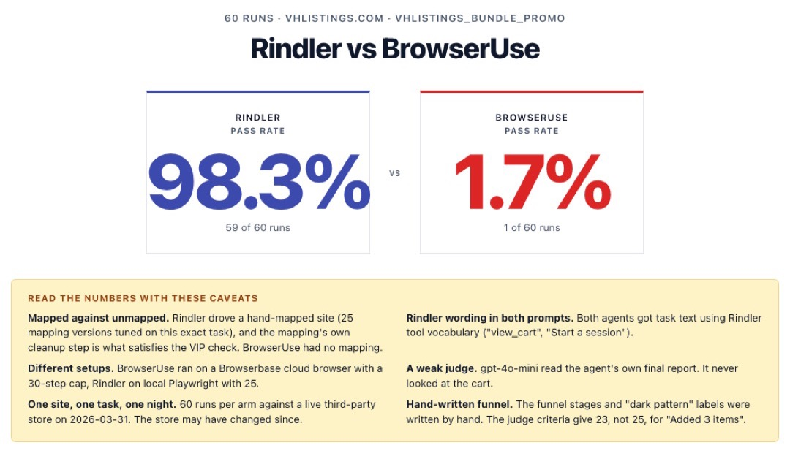
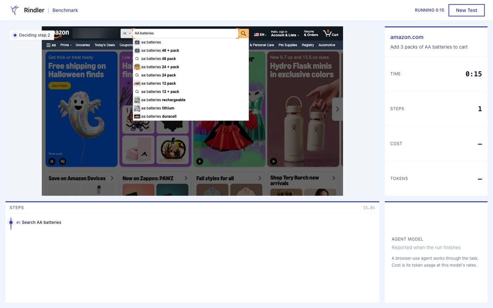
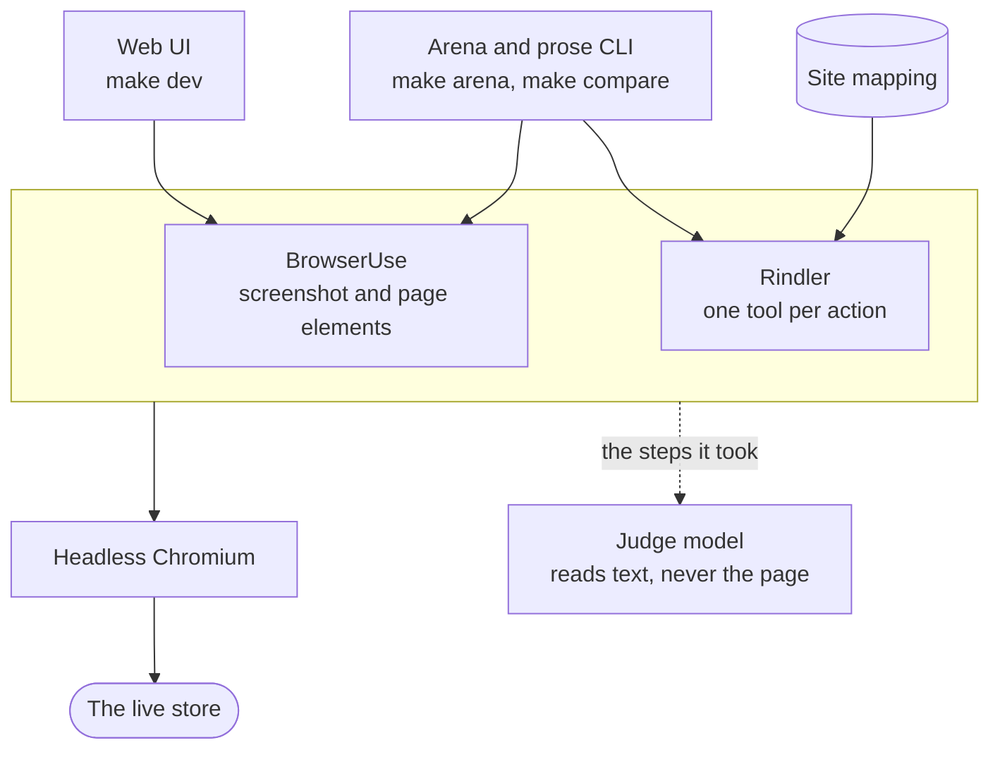

# agent-benchmark

We built this at Rindler to see what a hand-written map of a website is worth to a shopping agent. It gives two agents the same shopping task on a real store and keeps score.

- **BrowserUse** is [browser-use](https://github.com/browser-use/browser-use), a normal browser agent. Every step it looks at a screenshot and the page's elements and decides what to click next.
- **Rindler** gets a *site mapping* instead. Someone writes down the site's screens and the actions you can take on them (`search_products`, `add_to_cart`, `checkout`, ...), and every action becomes a tool. So the model picks from a handful of named tools and never reads the raw page.

A judge model grades each run, and every run logs its time, steps, tokens and cost.

The Rindler servers this used to talk to are retired, so this version runs on one machine with just an Anthropic API key. `server/rindler_local/` runs the mappings in-process instead, with Playwright doing the clicking.

## What we found

One night in March 2026, one task on vhlistings.com (a Shopify store), 60 runs per agent, both on gpt-4o.

| | Rindler | BrowserUse |
|---|---|---|
| judge passes | **59 / 60** | **1 / 60** |
| mean cost per run, as tokens at gpt-4o list price | $0.14 | $0.71 |

That's a huge gap, and it wasn't a fair fight. We had mapped that store by hand, and the mapping went through 25 versions tuned on that exact site and task, while BrowserUse had no map at all. Both agents even got task text written in Rindler's words ("Start a session", "call view_cart"). They didn't run on the same setup either. BrowserUse got a cloud browser and a 30-step cap, Rindler our own server and 25. The judge was gpt-4o-mini, a weak model, and it read each agent's own report instead of looking at the page. And the store has changed since, so those runs can't be reproduced against it now. [docs/results.md](docs/results.md) has the full table and all seven caveats.

What I'd take from it is that a hand-mapped site makes this task easy for an agent. Not that Rindler is a better agent than browser-use.

### And on Amazon

In October 2026 I wrote a mapping for amazon.com and ran both agents on two simple tasks, three times each, with claude-sonnet-5-5: add a USB-C cable under $15 to the cart, and add the paperback of *Atomic Habits*.

| | Rindler | BrowserUse |
|---|---|---|
| cable: passes | 3 / 3 | 3 / 3 |
| cable: mean cost per run | $0.013 | $0.14 |
| book: passes | 0 / 3 | 1 / 3 |

Every failure was Amazon's bot check, not the agent. On the cable, where nothing got in the way, both finished and Rindler did it for about a tenth of the cost. Three runs each is a small sample and the mapping was written for these two tasks, so read [the details](docs/results.md#amazon-october-2026) before making much of it.

<p align="center">
  
</p>

## Try it

You need [uv](https://docs.astral.sh/uv/getting-started/installation/), Node 20 or newer with npm, and `make`. It was built on an Apple silicon Mac and checked on Debian 12 too. Windows hasn't been tried.

```bash
cp .env.example .env   # then put your key after ANTHROPIC_API_KEY=
make setup             # once
make dev               # backend on 127.0.0.1:8000, web UI on http://localhost:5180
```

On a bare Linux box `make setup` may stop because Chromium is missing [system libraries](docs/configuration.md#requirements-and-setup), and it prints the command that fixes it.

Open the web UI, paste a store's address, pick one of the three tasks the model suggests and press **Run Benchmark**. You watch each step as it happens, then get the judge's verdict. Ctrl-C stops both servers.

Amazon works most of the time, though now and then it puts up a human check and the run fails there. The practice shop [automationexercise.com](https://automationexercise.com) always lets a bot in. Plenty of sites don't: Walmart and Target block headless browsers, and books.toscrape.com has no Add to basket button on a book's own page, so [a failure isn't always the agent's fault](docs/limits.md).



No key yet? `make demo` is the same UI with canned runs, no browser and no cost. `make test` runs every [test suite](docs/testing.md) offline, also without a key.

## How it works



The web UI only runs browser-use, on whatever site you paste. A head-to-head needs a site someone has mapped, and four have one. The arena has 32 scenarios, but Rindler can only run the ones on vhlistings.com, shipt.com and amazon.com. The CLI has ten tasks on prose.com. The arena and the CLI now give both agents the same model, the same step budget and neutral task text, which is more than March could say.

The judge never sees the site. It reads the task, the steps and what the agent reported, so a pass means the judge believed the agent.

Plain `make` lists every target. The main ones:

| | run it with | one run on claude-sonnet-5-5 costs |
|---|---|---|
| [Live benchmark](docs/live-benchmark.md) | `make dev` | $0.15 to $0.41 of agent tokens |
| [Arena](server/README.md) | `make arena AGENT=... SCENARIO=...` | about $0.02 to $0.03 on Rindler, $0.20 to $0.71 on BrowserUse |
| [prose CLI](cli/README.md) | `make compare TASK=...` | about 10 to 20 cents for both agents |
| [Log viewer](viewer/README.md) | `make viewer` | nothing, no key |

## Who built it

I'm Michelle Serrano (`meetchie`), and this is my rebuild of a benchmark we made at Rindler, our startup. At Rindler I built the web app, Michael Serrano built the arena and the server, and Arthur De Los Santos built the prose CLI.

In October 2026 I pulled it out of our monorepo and rebuilt it to run on one machine with one API key: Claude in place of OpenAI, a local engine that runs the site mappings, the Amazon mapping and its runs, a live preview of the agent's browser, and tests for all of it, over 1,200 now. The git history keeps everyone's original commits and dates, and [docs/provenance.md](docs/provenance.md) covers what changed on the way out.
