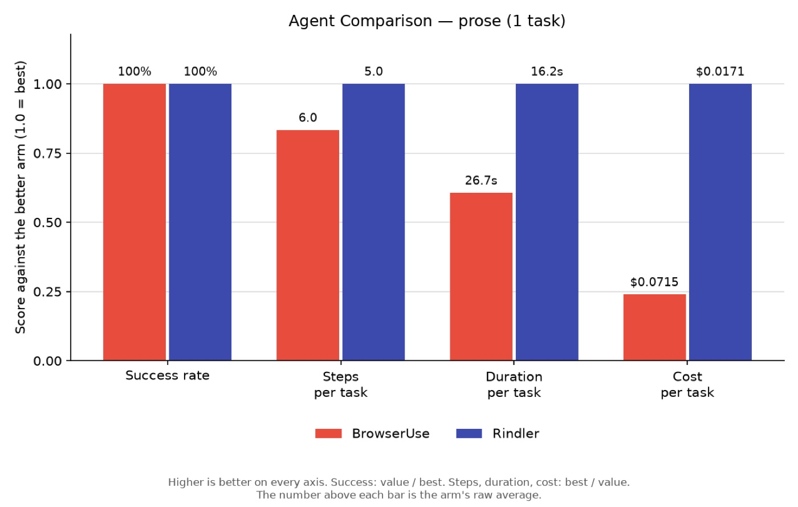

# Results

## The March 2026 result

`server/arena_logs/` holds the 137 original logs: 131 runs and 6 Rindler context logs. They are unchanged since extraction except for the redactions listed under [Provenance](provenance.md#redactions).

The headline is one task, `vhlistings_bundle_promo`, on the Shopify store vhlistings.com. The agent adds three items to the cart, applies the promo code `SPRING`, reaches checkout and stops before payment. The judge also fails the run if a "VIP Membership" the site adds on its own is still in the order. 60 runs per arm, all on 2026-03-31, both arms on gpt-4o:

| | Rindler | BrowserUse |
|---|---|---|
| judge passes | **59 / 60** | **1 / 60** |
| mean duration | about 70 s | about 307 s |
| mean cost per run | $0.14 | $0.71 |
| mean tokens | 52,856 | 272,377 |
| mean steps | 14.1 | 28.5 |

The costs are token counts priced at gpt-4o list rates ($2.50 and $10 per million input and output tokens), not billed amounts. Recomputed from the logs, Rindler cost $8.20 in total and BrowserUse $42.78. The viewer's results page shows the same figures.

`make analyze-march` prints exactly the headline set: all 60 BrowserUse logs and the last 60 Rindler ones, as `59/60 (98.3%)` against `1/60 (1.7%)`. Its header gives the first and last log time of that set, 2026-03-31 00:28:27 to 06:10:32. Plain `make analyze` counts all 66 Rindler `vhlistings_bundle_promo` logs, 65 of them passes, because it doesn't drop the 6 earlier runs. It also shows new arena runs, grouped by scenario, arm and agent model so they never mix with March.

The headline leaves out 8 Rindler logs that are in the folder and in the viewer's picker: earlier mapping versions and a different scenario.

## The seven caveats

Read the March result with every one of these.

1. Mapped against unmapped. The Rindler arm drove a site someone had mapped by hand: 25 versions of the mapping, tuned on this exact site and task. The mapping's own cleanup step is what meets the "no VIP Membership" criterion. BrowserUse had no mapping.
2. The prompts used Rindler's vocabulary. The task text both arms got said things like "Start a session", "call view_cart" and "remove_from_cart". The 2026-03-19 shipt Rindler goal even says "using Rindler's semantic commerce tools". That text has since been removed from the scenarios.
3. Different setups. BrowserUse ran in a Browserbase cloud browser with a 30-step cap. Rindler ran Playwright on Rindler's own server with a 25-step cap. Both used gpt-4o.
4. A weak judge. The judge was gpt-4o-mini reading the agent's own final report. BrowserUse's single pass shows it can err in either direction. `Agent Reported Success: True` is in every log of both arms and only means the run didn't crash, so ignore it. Twelve BrowserUse logs say the agent hit the step limit, and 47 of the 60 BrowserUse runs used all 30 steps.
5. One site, one task, one night. 60 runs per arm on 2026-03-31 against a live third-party store with a Klaviyo popup and an asynchronous Shopify checkout. The store has changed since, and these runs can't be reproduced against it. The viewer's failure funnel and its "dark pattern" labels were hand-curated by the original authors, not derived from the logs.
6. The shipt numbers are tiny. `arena_logs/` has 1 BrowserUse run against 2 Rindler runs. The February comparisons of BrowserUse against BrowserUse with Rindler's tools over MCP exist only in the git history. They used a judge that was revised on 2026-03-17 and must not be pooled with March.
7. Time. The timestamps in the log file names are the runner's local time, not UTC. The commits of that night are at UTC-4.

## Local runs, October 2026

On 2026-10-24 the web app, the arena and the CLI were run again in this standalone form, all on claude-sonnet-5-5. The web app and the arena's `vhlistings_add_to_cart` ran again on 2026-10-25, after their judges were given more to read.

### Live benchmark runs

These are web app runs from 2026-10-24, with claude-sonnet-5-5 as agent, judge and task generator. The judge then read the step text only, not yet the agent's evaluations, action results or final report. Each row is a task the model generated that day, so the same site can give a different task on another try. The cost is the agent's, as the results screen shows it. The judge adds about a cent and generating tasks two to four cents.

| site | task | verdict | steps | time | agent cost |
|---|---|---|---|---|---|
| books.toscrape.com | generated: add a book to the basket | fail | 10 to 16 | 55 to 76 s | $0.28 to $0.41 |
| sauce-demo.myshopify.com | generated: add 3 grey jackets in a chosen size to the cart | fail | 11 | 50 s | $0.19 |
| automationexercise.com | add 4 of a specific top to the cart via search, and verify the cart | **PASS** | 11 | 48 s | $0.16 |

Each row is one run except books.toscrape.com, which is two (hence the ranges). That shows the live benchmark works end to end. It says nothing about how often it passes.

books.toscrape.com has no Add to basket button on a book's own page, so a generated task for it can fail whatever the agent does. The agent says so and the judge fails the run. The sauce-demo task assumed a "Medium" size and a quantity field that old Shopify theme doesn't have, and the judge, reading step descriptions only, couldn't confirm the size or the total. The pass is the agent searching for "top", closing an ad, opening the product, setting the quantity to 4 and checking the cart.

Those three were judged from the step descriptions alone. With the evaluations, action results and final report added to what the judge reads, the same kind of automationexercise.com task (Blue Top, quantity 4, check the total) ran again on 2026-10-25 through `POST /benchmark/start`. It passed in 8 steps and 42 s for $0.15, judge $0.012, and the judge's summary names the quantity 4, the Rs. 500 price and the Rs. 2000 total the agent reported.

### Arena and CLI runs

On 2026-10-24 the arms ran again in this standalone form: claude-sonnet-5-5 for agent and judge, both arms local, equal budgets, neutral task text. Each row is the last run of that arm and scenario that day, and most ran once. The Rindler `vhlistings_product_attribute_search` arm ran twice, before and after a pagination fix in its mapping.

These runs show the setup works and nothing else. They are not comparable to the March numbers, and a run or two per arm can't say which arm is better.

| scenario | arm | verdict | steps | time | agent cost |
|---|---|---|---|---|---|
| `vhlistings_product_attribute_search` | RINDLER | PASS | 8 | 54.6 s | $0.028 |
| `vhlistings_product_attribute_search` | BROWSERUSE | FAIL | 23 | 138.9 s | $0.459 |
| `vhlistings_add_to_cart` | RINDLER | PASS | 6 | 33.6 s | $0.021 |
| `vhlistings_add_to_cart` | BROWSERUSE | PASS | 7 | 45.6 s | $0.215 |
| prose.com `add-hair-towel` (CLI) | Rindler | pass | 5 | 18.1 s | $0.018 |
| prose.com `add-hair-towel` (CLI) | BrowserUse | pass | 7 | 36.4 s | $0.170 |
| prose.com `add-candle` (CLI) | Rindler | pass | 5 | 16.2 s | $0.017 |
| prose.com `add-candle` (CLI) | BrowserUse | pass | 6 | 26.7 s | $0.072 |

The judge now reads every step's arguments as well as its action name. The judge behind these rows read the action name only, which says what a Rindler step did (`search_products`) but not what a BrowserUse step did (`navigation`, `click`). So the BrowserUse `vhlistings_add_to_cart` PASS came from a run whose report said it searched, and a run the next day that opened the search URL without saying so in its report was failed for never searching. With the current judge, `vhlistings_add_to_cart` passed on both arms in 6 steps: Rindler in 34.4 s for $0.021, and BrowserUse in 40.3 s for $0.201, with the judge citing the `search?q=belt` URL.

The BrowserUse `vhlistings_product_attribute_search` arm ran four times while the browser-use adapter was being fixed, and all four failed. The first, at 9 steps, 109 s and $0.589, came before the fix, when the model answered with the action itself and the adapter asked again to have it wrapped, so its 9 steps took 21 API calls. The three on the final code made one API call per step with no repairs and took 27 steps for $0.586, 27 for $0.709 and 23 for $0.459, the last being the table's row. The task can't be completed on today's store, so how long the agent keeps looking varies from run to run, and 23 or 27 steps against 9 says nothing about speed. The `add-hair-towel` BrowserUse row is also from before the fix, since its log shows the old repair calls, and was not run again.

The first scenario is a warning about the judge. The store no longer sells the chain belt March's run picked, so the Rindler arm added a $52 belt with "chain" in its name. Two Rindler runs made that choice, and the judge passed one and failed the other. The BrowserUse arm searched three result pages and a second query and found no chain belt under $35. It added the same belt as the closest fallback and said in its report that it was neither a chain belt (its page says genuine leather) nor under $35, and the judge failed it. A PASS here is the judge accepting a report built on a product's name. [server/README.md](../server/README.md) has the full story.

In practice, on single claude-sonnet-5-5 runs, a Rindler arm run costs a few cents and anything driven by browser-use costs several times that, as the table shows. The live benchmark runs above cost $0.15 to $0.41 each.

  

One of the charts `cli/viz.sh` draws, here for the `add-candle` run above. Each bar is scored against the better arm, and the number above it is the arm's raw average.
